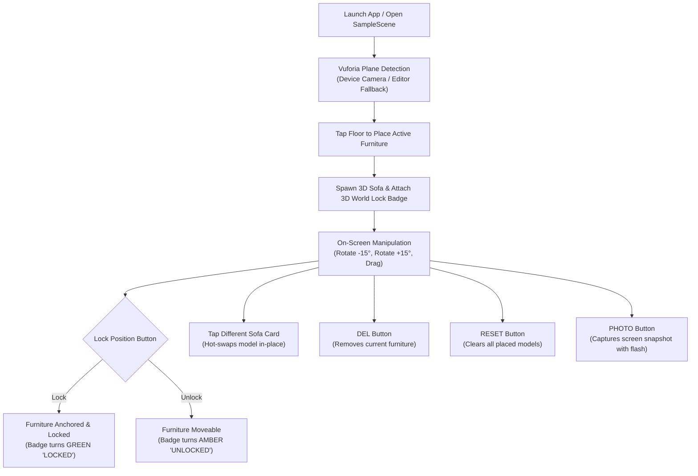

# Product Documentation & Architecture Guide

## 1. Product Overview
**Furnish AR** is a mobile Augmented Reality (AR) interior design and e-commerce visualization application built in **Unity 2022.3.62f3 LTS** powered entirely by the **PTC Vuforia Engine**.

The app enables users to preview true-to-scale 3D furniture models within their physical living environment or inside the Unity Editor with high-fidelity lighting and materials. Users can intuitively position, rotate, lock, remove, and switch between furniture models using an ergonomic, high-contrast control layout designed for handheld mobile use.

---

## 2. Core Capabilities & User Flow



### 2.1 Vuforia Augmented Reality Tracking
- **AR Engine:** PTC Vuforia Engine 11.4.4.
- **Tracking Mechanism:** `PlaneFinderBehaviour` with `HitTestMode.AUTOMATIC` and device ground plane tracking.
- **Floor Hit Testing:** `VuforiaBehaviour.Instance.World.HitTest(screenPosition, 1.4f, out HitTestResult hitResult)` calculates the real-world metric surface position and normal.
- **Zero ARCore / Zero AR Foundation:** ARCore and AR Foundation have been completely removed from packages, scene hierarchy, and build settings in favor of Vuforia's cross-platform engine.

### 2.2 WYSIWYG In-Editor Scene Visibility
- Unlike standard ARFoundation setups that render a blank gray screen inside the Unity Editor, Furnish AR bakes all UI elements directly into [`Assets/Scenes/SampleScene.unity`](file:///home/anni/Furnish_Ar/Assets/Scenes/SampleScene.unity).
- Includes an editor-friendly fallback photographic room background ([`Assets/Resources/Textures/Backgrounds/living_room_bg.png`](file:///home/anni/Furnish_Ar/Assets/Resources/Textures/Backgrounds/living_room_bg.png)) allowing immediate visual inspection, testing, and UI tuning in the Editor Scene and Game views without compiling to APK.

### 2.3 Prominent On-Screen Navigation & Controls
- **Top Header:**
  - `RESET`: Clears all active and locked furniture instances.
  - `StatusLabel`: Real-time contextual guidance (e.g., *"Tap floor to place White Sofa"*, *"White Sofa placed - Rotate or Lock"*).
  - `PHOTO`: Captures full-resolution screenshot with a camera shutter flash animation.
- **Unified Bottom Panel:**
  - **Manipulation Row:**
    - `ROTATE L (-15°)`: Smooth counter-clockwise 15-degree increment rotation.
    - `LOCK POSITION`: Large, high-visibility turquoise call-to-action that toggles between locking and unlocking the active furniture.
    - `ROTATE R (+15°)`: Smooth clockwise 15-degree increment rotation.
    - `DEL`: Removes the currently active furniture item.
  - **Sofa Selection Row:**
    - Displays cards for all 3 real 3D sofa models with high-resolution thumbnail previews, title labels, and an `ACTIVE` status badge on the currently selected item.
    - Tapping another sofa hot-swaps the active model in place without losing position or rotation.

### 2.4 3D World-Space Lock Badge
- When a furniture piece is placed in the scene, [`FurnitureLockBadge`](file:///home/anni/Furnish_Ar/Assets/Scripts/FurnitureLockBadge.cs) instantiates a world-space billboard badge directly above the highest vertex bound of the model.
- **Unlocked State:** Amber badge (`#E98C1E`) displaying `UNLOCKED`.
- **Locked State:** Emerald green badge (`#0FA870`) displaying `LOCKED`.
- Automatically faces the active camera at all times with smooth billboarding.

---

## 3. Technology Stack & Target Specifications

| Component | Specification |
| :--- | :--- |
| **Unity Version** | `2022.3.62f3 LTS` |
| **AR Framework** | **PTC Vuforia Engine `11.4.4`** |
| **Target OS** | **Android 14 (API Level 34)** |
| **Minimum OS** | Android 7.0 Nougat (API Level 24) |
| **Scripting Backend** | **IL2CPP** |
| **Target Architecture**| **ARM64 (64-bit)** |
| **UI System** | Unity UI (uGUI Canvas) with Scaler set to 1080×2400 |
| **Code Standard** | Zero comments (`//`, `/* */`), zero emojis across all C# scripts |

---

## 4. Project Directory Structure

```
Furnish_Ar/
├── Assets/
│   ├── Assets/
│   │   ├── Furnitures/                     # Real 3D Models & Prefabs
│   │   │   ├── White Sofa/                 # White Sofa prefab, materials, textures, meshes
│   │   │   ├── Brown Sofa/                 # Brown Sofa prefab, materials, textures, meshes
│   │   │   └── Light Brown Sofa/           # Light Brown Sofa prefab, materials, textures, meshes
│   │   └── UI/                             # 1:1 original sofa preview images
│   ├── Editor/
│   │   ├── BuildScript.cs                  # Headless & batchmode Android build automation
│   │   └── SceneUIBuilder.cs               # One-click scene UI baker & hierarchy generator
│   ├── Resources/
│   │   └── Textures/
│   │       ├── Backgrounds/
│   │       │   └── living_room_bg.png      # Fallback editor living room photographic plane
│   │       └── Furniture/
│   │           ├── sofa_white_card.png     # Selection card thumbnail for White Sofa
│   │           ├── sofa_brown_card.png     # Selection card thumbnail for Brown Sofa
│   │           └── sofa_light_brown_card.png # Selection card thumbnail for Light Brown Sofa
│   ├── Scenes/
│   │   └── SampleScene.unity               # Fully baked AR & UI scene
│   └── Scripts/
│       ├── ARFurnitureAppManager.cs        # UI controller, sofa switcher, snapshot & toast manager
│       ├── furniturePlacementManager.cs    # Vuforia hit-test placement, rotation & lock manager
│       └── FurnitureLockBadge.cs           # 3D world-space floating lock/unlock status badge
├── Packages/
│   ├── manifest.json                       # Vuforia scoped registry & Unity dependencies
│   └── packages-lock.json                  # Resolved dependency tree
├── ProjectSettings/
│   ├── ProjectSettings.asset               # Target API 34, ARM64, IL2CPP
│   └── EditorBuildSettings.asset           # Active scene list (SampleScene only)
├── DESIGN.md                               # UI visual tokens, dimensions & component design system
└── PRODUCT.md                              # This document
```

---

## 5. Developer Guide: Building & Extending

### 5.1 Opening the Project in Unity
1. Ensure **Unity 2022.3.62f3** is installed via Unity Hub with **Android Build Support** (Android SDK & NDK tools, OpenJDK).
2. Open the project directory (`Furnish_Ar`).
3. Unity Package Manager automatically resolves `com.ptc.vuforia.engine` version `11.4.4` via the Vuforia scoped registry specified in [`Packages/manifest.json`](file:///home/anni/Furnish_Ar/Packages/manifest.json).

### 5.2 Rebaking or Updating the UI
If you modify UI dimensions or styling in [`Assets/Editor/SceneUIBuilder.cs`](file:///home/anni/Furnish_Ar/Assets/Editor/SceneUIBuilder.cs):
1. In the Unity Editor menu bar, click: **`Furnish AR -> Bake UI To Scene`**.
2. The script cleans any stale hierarchy and generates the modern canvas layout directly in `SampleScene.unity`.
3. Press **Ctrl+S** to save the scene.

### 5.3 Adding a New Furniture Model
1. Place your 3D prefab in `Assets/Assets/Furnitures/<ModelName>/`.
2. Add a square 512×512 PNG card preview in `Assets/Resources/Textures/Furniture/sofa_<model>_card.png`.
3. Open [`Assets/Scripts/ARFurnitureAppManager.cs`](file:///home/anni/Furnish_Ar/Assets/Scripts/ARFurnitureAppManager.cs):
   - In `InitSofaChoices()`, register a new `SofaChoice` entry with `id`, `name`, `thumbnailPath`, and assign the prefab.
4. Open [`Assets/Editor/SceneUIBuilder.cs`](file:///home/anni/Furnish_Ar/Assets/Editor/SceneUIBuilder.cs):
   - Add a call to `CreateSofaCard(...)` inside the `sofaRow` creation block.
   - Run **`Furnish AR -> Bake UI To Scene`** to bake the new card into the scene.

### 5.4 Building the Android APK
From the Unity Editor:
- Go to **File -> Build Settings -> Android -> Build**.

Or via Command Line / Headless Batchmode:
```bash
/path/to/Unity -quit -batchmode -projectPath . -executeMethod BuildScript.BuildAndroid -logFile build.log
```
The output APK will be generated at `Builds/Android/FurnishAR.apk`.
