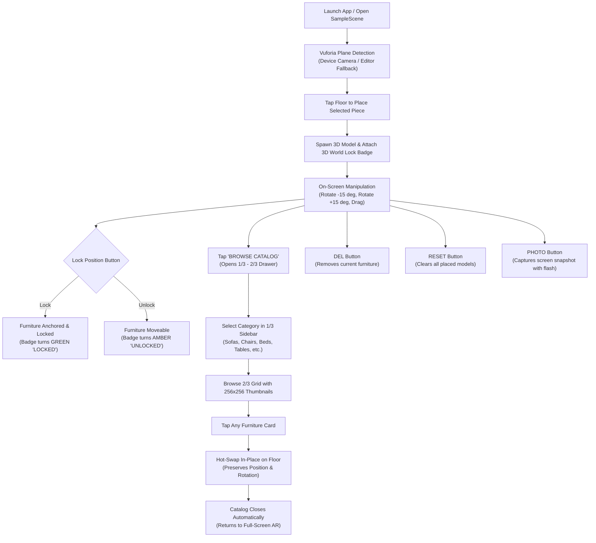

# Product Documentation & Architecture Guide

## 1. Product Overview
**Furnish AR** is a mobile Augmented Reality (AR) interior design and e-commerce visualization application built in **Unity 2022.3.62f3 LTS** powered entirely by the **PTC Vuforia Engine**.

The app enables users to preview true-to-scale 3D furniture models within their physical living environment or inside the Unity Editor with high-fidelity lighting and materials. Users can intuitively position, rotate, lock, remove, and switch between furniture models using an ergonomic, high-contrast control layout designed for handheld mobile use.

The application features a comprehensive **9-Category Catalog Suite** comprising **75 curated 3D furniture models** (Sofas, Chairs, Beds, Tables, Closets, Drawers, Bathroom, Kitchen, Cushions) accessible via an intuitive **1/3 Sidebar and 2/3 Grid** modal drawer.

---

## 2. Core Capabilities & User Flow



### 2.1 Vuforia Augmented Reality Tracking
- **AR Engine:** PTC Vuforia Engine 11.4.4.
- **Tracking Mechanism:** `PlaneFinderBehaviour` with `HitTestMode.AUTOMATIC` and device ground plane tracking.
- **Floor Hit Testing:** `VuforiaBehaviour.Instance.World.HitTest(screenPosition, 1.4f, out HitTestResult hitResult)` calculates the real-world metric surface position and normal.
- **Zero ARCore / Zero AR Foundation:** ARCore and AR Foundation have been completely removed from packages, scene hierarchy, and build settings in favor of Vuforia's cross-platform engine.

### 2.2 WYSIWYG In-Editor Scene Visibility
- Unlike standard ARFoundation setups that render a blank gray screen inside the Unity Editor, Furnish AR bakes all UI elements directly into [`Assets/Scenes/SampleScene.unity`](file:///home/anni/Furnish_Ar/Assets/Scenes/SampleScene.unity).
- Includes an editor-friendly fallback photographic room background ([`Assets/Resources/Textures/Backgrounds/living_room_bg.png`](file:///home/anni/Furnish_Ar/Assets/Resources/Textures/Backgrounds/living_room_bg.png)) allowing immediate visual inspection, testing, and UI tuning in the Editor Scene and Game views without compiling to APK.

### 2.3 Prominent On-Screen Navigation & Controls
- **Top Header:**
  - `RESET`: Clears all active and locked furniture instances.
  - `StatusLabel`: Real-time contextual guidance (e.g., *"Tap floor to place White Sofa"*, *"POSITIONING WHITE SOFA - Tap LOCK to fix"*, *"1 PIECE(S) LOCKED - Tap floor to place another"*).
  - `PHOTO`: Captures full-resolution screenshot with a camera shutter flash animation.
- **Unified Bottom Panel:**
  - **Control Row:**
    - `ROTATE L (-15 deg)`: Smooth counter-clockwise 15-degree increment rotation.
    - `LOCK POSITION`: Large, high-visibility turquoise call-to-action that toggles between locking and unlocking the active furniture.
    - `ROTATE R (+15 deg)`: Smooth clockwise 15-degree increment rotation.
    - `DEL`: Removes the currently active furniture item or last placed item.
  - **Catalog Launcher Row:**
    - `ActiveItemCard` (Left, width 320 px): Displays the thumbnail of the currently selected piece, "CURRENT SELECTION" tag, item name, and "READY TO PLACE" pill. Tapping it opens the catalog.
    - `OpenCatalogBtn` (Right, width 644 px): Large teal button with bold typography: *"BROWSE CATALOG"*, *"9 Categories - 75 Furniture Pieces"*, and `"[ OPEN 1/3 SIDEBAR & 2/3 GRID -> ]"`. Tapping opens the full catalog modal.

### 2.4 1/3 Sidebar and 2/3 Grid Catalog Suite
- When the user taps `"BROWSE CATALOG"`, a full-height modal drawer opens over a dark translucent backdrop (`rgba(20,20,25,0.72)`).
- **1/3 Category Sidebar (320 px width):**
  - Features 9 category filter buttons:
    1. **Sofas** (11 curated pieces: White Sofa, Brown Sofa, Light Brown Sofa, Modern Sofa 01-08)
    2. **Chairs** (8 curated armchairs: Armchair 01-08)
    3. **Beds** (8 curated beds: Comfort Bed 01-08)
    4. **Tables** (8 curated tables: Dining Table 01-08)
    5. **Closets** (8 curated wardrobes: Wardrobe 01-08)
    6. **Drawers** (8 curated drawers: Storage Drawer 01-08)
    7. **Bathroom** (8 curated fixtures: Vanity Unit 01-07, Soaking Tub 01)
    8. **Kitchen** (8 curated units: Kitchen Cabinet 01-07, Kitchen Sink Unit)
    9. **Cushions** (8 curated accents: Accent Cushion 01-08)
  - Selecting any category highlights the button with teal accent (`#2EB0B0`), white text, and right indicator bar, while instantly displaying the matching items in the 2/3 grid.
- **2/3 Furniture Grid (698 px width):**
  - 2-column scrollable grid of tactile cards (320 × 340 px).
  - Each card features:
    - High-resolution 256×256 studio thumbnail with transparent/warm background.
    - Clean bold item name label (e.g., *"White Sofa"*, *"Armchair 01"*, *"Kitchen Sink Unit"*).
    - Bold teal `"SELECT & PLACE"` action hint.
    - `"ACTIVE"` teal badge if this is the currently selected piece.
  - Tapping any card immediately selects the item, performs an in-place hot swap if an unlocked piece is on the floor, closes the modal, and returns to full AR view with a confirmation toast.

### 2.5 In-Place Hot-Swapping
- If a furniture model is already placed on the floor (unlocked), selecting a new model from the catalog immediately replaces it at the exact same floor coordinate and rotation angle.
- The 3D World Lock Badge automatically updates to match the newly swapped model's height bounds.
- If no model is currently on the floor, selecting a piece primes it for immediate floor placement upon the next tap.

### 2.6 3D World-Space Lock Badge
- When a furniture piece is placed in the scene, [`FurnitureLockBadge`](file:///home/anni/Furnish_Ar/Assets/Scripts/FurnitureLockBadge.cs) instantiates a world-space billboard badge directly above the highest vertex bound of the model.
- **Unlocked State:** Amber badge (`#E98C1E`) displaying `UNLOCKED`.
- **Locked State:** Emerald green badge (`#0FA870`) displaying `LOCKED`.
- Automatically faces the active camera at all times with smooth billboarding.

---

## 3. Technology Stack & Target Specifications

| Component | Specification |
| :--- | :--- |
| **Unity Version** | `2022.3.62f3 LTS` |
| **AR Framework** | **PTC Vuforia Engine `11.4.4`** |
| **Target OS** | **Android 14 (API Level 34)** |
| **Minimum OS** | Android 7.0 Nougat (API Level 24) |
| **Scripting Backend** | **IL2CPP** |
| **Target Architecture**| **ARM64 (64-bit)** |
| **UI System** | Unity UI (uGUI Canvas) with Scaler set to 1080×2400 |
| **Catalog Scale** | **9 Categories, 75 Curated 3D Models, 75 Studio Sprites** |
| **Asset Footprint** | **~390 MB (Pruned 1,273 unused files / 1.39 GB removed)** |
| **Code Standard** | Zero comments (`//`, `/* */`), zero emojis across all C# scripts |

---

## 4. Project Directory Structure

```
Furnish_Ar/
├── Assets/
│   ├── Assets/
│   │   └── Furnitures/                     # Original 3D Models & Prefabs
│   │       ├── White Sofa/                 # White Sofa prefab, materials, textures, meshes
│   │       ├── Brown Sofa/                 # Brown Sofa prefab, materials, textures, meshes
│   │       └── Light Brown Sofa/           # Light Brown Sofa prefab, materials, textures, meshes
│   ├── Furniture Mega Pack/                # Curated 3D Furniture Assets Suite (Pruned to Active 72 Models)
│   │   ├── FBX/                            # Active model geometry
│   │   ├── Materials/                      # Active PBR surface materials
│   │   ├── Prefabs/                        # Categorized Prefabs (8 per category)
│   │   │   ├── Bathroom/                   # Bathroom vanities and tub
│   │   │   ├── Beds/                       # Beds 01-08
│   │   │   ├── Chairs/                     # Armchairs 01-08
│   │   │   ├── Closets/                    # Wardrobes 01-08
│   │   │   ├── Cushioins/                  # Accent cushions 01-08
│   │   │   ├── Drawers/                    # Storage drawers 01-08
│   │   │   ├── Kitchen/                    # Kitchen cabinets and sink
│   │   │   ├── Sofas/                      # Modern sofas 01-08
│   │   │   └── Tables/                     # Dining tables 01-08
│   │   └── Textures/                       # Active PBR surface maps
│   ├── Editor/
│   │   ├── BuildScript.cs                  # Headless & batchmode Android build automation
│   │   ├── CatalogThumbnailBaker.cs        # Studio camera thumbnail generation automation
│   │   └── SceneUIBuilder.cs               # One-click scene UI baker & 1/3-2/3 catalog suite generator
│   ├── Resources/
│   │   └── Textures/
│   │       ├── Backgrounds/
│   │       │   └── living_room_bg.png      # Fallback editor living room photographic plane
│   │       └── Catalog/                    # 75 Baked 256x256 Studio Sprites (692 KB total)
│   │           ├── Bathroom/               # 8 bathroom fixture sprites
│   │           ├── Beds/                   # 8 bed sprites
│   │           ├── Chairs/                 # 8 chair sprites
│   │           ├── Closets/                # 8 closet sprites
│   │           ├── Cushions/               # 8 cushion sprites
│   │           ├── Drawers/                # 8 drawer sprites
│   │           ├── Kitchen/                # 8 kitchen unit sprites
│   │           ├── Sofas/                  # 11 sofa sprites (including originals)
│   │           └── Tables/                 # 8 table sprites
│   ├── Scenes/
│   │   └── SampleScene.unity               # Fully baked AR & 1/3-2/3 catalog scene
│   └── Scripts/
│       ├── ARFurnitureAppManager.cs        # UI controller, 9-category catalog manager, hot-swap & snapshot
│       ├── furniturePlacementManager.cs    # Vuforia hit-test placement, rotation & lock manager
│       └── FurnitureLockBadge.cs           # 3D world-space floating lock/unlock status badge
├── Packages/
│   ├── manifest.json                       # Vuforia scoped registry & Unity dependencies
│   └── packages-lock.json                  # Resolved dependency tree
├── ProjectSettings/
│   ├── ProjectSettings.asset               # Target API 34, ARM64, IL2CPP
│   └── EditorBuildSettings.asset           # Active scene list (SampleScene only)
├── DESIGN.md                               # UI visual tokens, 1/3-2/3 layout specifications & component system
└── PRODUCT.md                              # This document
```

---

## 5. Developer Guide: Building & Extending

### 5.1 Opening the Project in Unity
1. Ensure **Unity 2022.3.62f3** is installed via Unity Hub with **Android Build Support** (Android SDK & NDK tools, OpenJDK).
2. Open the project directory (`Furnish_Ar`).
3. Unity Package Manager automatically resolves `com.ptc.vuforia.engine` version `11.4.4` via the Vuforia scoped registry specified in [`Packages/manifest.json`](file:///home/anni/Furnish_Ar/Packages/manifest.json).

### 5.2 Rebaking or Updating the UI
If you modify UI dimensions, add categories, or change styling in [`Assets/Editor/SceneUIBuilder.cs`](file:///home/anni/Furnish_Ar/Assets/Editor/SceneUIBuilder.cs):
1. In the Unity Editor menu bar, click: **`Furnish AR -> Bake UI To Scene`**.
2. The script cleans any stale hierarchy and generates the modern canvas layout directly in `SampleScene.unity`.
3. Press **Ctrl+S** to save the scene.

### 5.3 Regenerating Catalog Thumbnails
If new 3D prefabs are added to `Assets/Furniture Mega Pack/`:
1. In the Unity Editor menu bar, click: **`Furnish AR -> Bake All Catalog Thumbnails`**.
2. The offscreen studio lighting camera renders high-resolution 256×256 PNGs directly into `Assets/Resources/Textures/Catalog/<Category>/`.
3. The assets are automatically configured with `Sprite (2D and UI)` import settings.

### 5.4 Building the Android APK
From the Unity Editor:
- Go to **File -> Build Settings -> Android -> Build**.

Or via Command Line / Headless Batchmode:
```bash
/home/anni/Unity/Hub/Editor/2022.3.62f3/Editor/Unity -quit -batchmode -projectPath /home/anni/Furnish_Ar -executeMethod BuildScript.BuildAndroid -logFile build.log
```
The output APK will be generated at `Builds/Android/FurnishAR.apk`.
